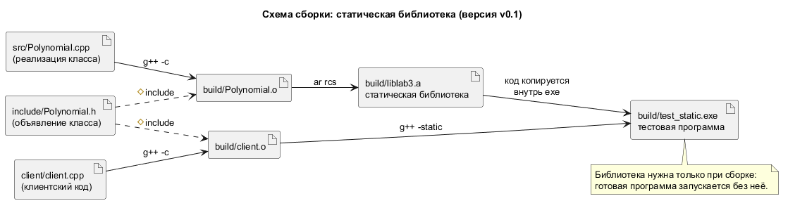

# Лабораторная работа №5 по ООП

[](https://github.com/Vareshka86/Lab5_OOP_try1/releases)

Статическая и динамическая библиотеки на C++14 — консольная программа по лабораторной работе №5.

Проект выполняет [лабораторную работу №5](https://aleksandr-003.github.io/labs/OOP_z/Labs1_5.html) курса «Объектно-ориентированное программирование и проектирование» (А. Д. Смородинов): класс `Polynomial` из лабораторной работы №3 собирается в статическую и динамическую библиотеки и подключается к одному и тому же клиентскому коду. Работа сдаётся по частям: каждая часть выходит отдельной версией. Сейчас выполнена часть 1 из 3: многофайловый проект, клиентский код и статическая библиотека `liblab3.a`.

```console
$ .\build_static.bat
Сборка успешна: build\liblab3.a, build\test_static.exe
$ .\build\test_static.exe
Клиент библиотеки lab3: проверка класса Polynomial

--- 1. Создание и значения ---
[OK]     многочлен x² - 3x + 2 записан в виде «x² - 3x + 2»
[OK]     P(0) = 2 и P(3) = 2 (схема Горнера)
...
--- 5. Исключения, брошенные библиотекой ---
[OK]     бесконечный коэффициент: клиент поймал std::invalid_argument
[OK]     деление на 0: std::invalid_argument, многочлен прежний «x² + 2x + 3»
[OK]     переполнение: std::overflow_error, коэффициент прежний
[OK]     после исключений счётчик многочленов верный: остались p и big

Итог: проверок пройдено 23 из 23
```

*Клиентский код проверил класс, подключённый из статической библиотеки: операции, статические счётчики и исключения, которые бросает код библиотеки. Остальной вывод сокращён до `...`.*



*Схема сборки в PlantUML (исходник — `uml/Build.puml`).*

## Части работы

| № | Что требуется | Версия | Статус |
|---|---------------|--------|--------|
| 1 | Многофайловый проект на основе ЛР №3 (`Polynomial.h`, `Polynomial.cpp`), клиентский код, статическая библиотека `liblab3.a`, программа `test_static.exe`; сборка вручную через g++ и ar | [v0.1](https://github.com/Vareshka86/Lab5_OOP_try1/releases/tag/v0.1) | Выполнено |
| 2 | Динамическая библиотека `lab3.dll` и библиотека импорта `lab3.lib`; программа `test_dynamic.exe` с тем же клиентским кодом | — | Запланировано |
| 3 | Сравнение двух программ, отличия статической и динамической сборки, итог | — | Запланировано |

## Требования

- Компилятор g++ и архиватор ar из MinGW-w64 с поддержкой C++14. Проверено на g++ 16.2.0 (MinGW-w64, Windows 11).
- Doxygen — для сборки документации, необязательно. Проверено на версии 1.18.0.
- PlantUML — чтобы перерисовать схему сборки, необязательно. Проверено на версии 1.2026.8 (Java 8).

## Установка

```bash
git clone https://github.com/Vareshka86/Lab5_OOP_try1.git
cd Lab5_OOP_try1
```

Без git: откройте [Releases](https://github.com/Vareshka86/Lab5_OOP_try1/releases), скачайте архив **Source code (zip)** нужной версии и распакуйте его. Обновить клонированный репозиторий: `git pull`.

## Сборка и запуск

**Windows** (cmd или PowerShell):

```console
$ .\build_static.bat
Сборка успешна: build\liblab3.a, build\test_static.exe
```

```powershell
.\build\test_static.exe
```

Что произошло:

- `build_static.bat` выполнил четыре команды вручную, без make и CMake: скомпилировал класс в `Polynomial.o`, упаковал его в `liblab3.a` командой `ar`, скомпилировал клиент в `client.o` и слинковал `test_static.exe`; предупреждений компилятора нет.
- Тестовая программа выполнила 23 проверки и вернула код 0. Код класса скопирован в exe, поэтому `liblab3.a` нужна только при сборке.

Те же команды можно набрать по одной — они перечислены на странице [«Часть 1»](pages/part1.md).

**Linux и macOS** — на этих системах сборка не проверялась:

```bash
g++ -std=c++14 -Iinclude -c src/Polynomial.cpp -o Polynomial.o
ar rcs liblab3.a Polynomial.o
g++ -std=c++14 -Iinclude client/client.cpp liblab3.a -o test_static
./test_static
```

## Как это работает

Класс `Polynomial` — многочлен второй степени ax² + bx + c — взят из лабораторной работы №3 без изменений кода: объявление лежит в `include/Polynomial.h`, определения — в `src/Polynomial.cpp`. Из `Polynomial.cpp` получается объектный файл, а `ar` упаковывает его в статическую библиотеку `liblab3.a`.

Клиентский код `client/client.cpp` пользуется только открытым интерфейсом класса и не знает, какая библиотека подключена; во второй части он останется тем же, а изменится только способ линковки. Он проверяет и то, что важно именно для библиотек: статические счётчики класса живут внутри библиотеки, а исключения бросает её код и ловит клиент. Подробное описание, объяснение понятия «статическая библиотека» и результаты проверок — на странице [«Часть 1. Многофайловый проект и статическая библиотека»](pages/part1.md).

## Документация

Комментарии в коде оформлены для Doxygen. Соберите документацию:

```bash
doxygen Doxyfile
```

Откройте `docs/html/index.html`. Сборка проходит без предупреждений. Что изменилось в каждой версии — в [CHANGELOG.md](CHANGELOG.md).

## Версии

Каждая часть выполняется в отдельной ветке (`part1`, …), исправления — в ветках `fix-…`. Готовая ветка сливается в `main`, и на результат ставится метка версии: [список версий](https://github.com/Vareshka86/Lab5_OOP_try1/releases).

---

Выполнил: Vareshka86.
